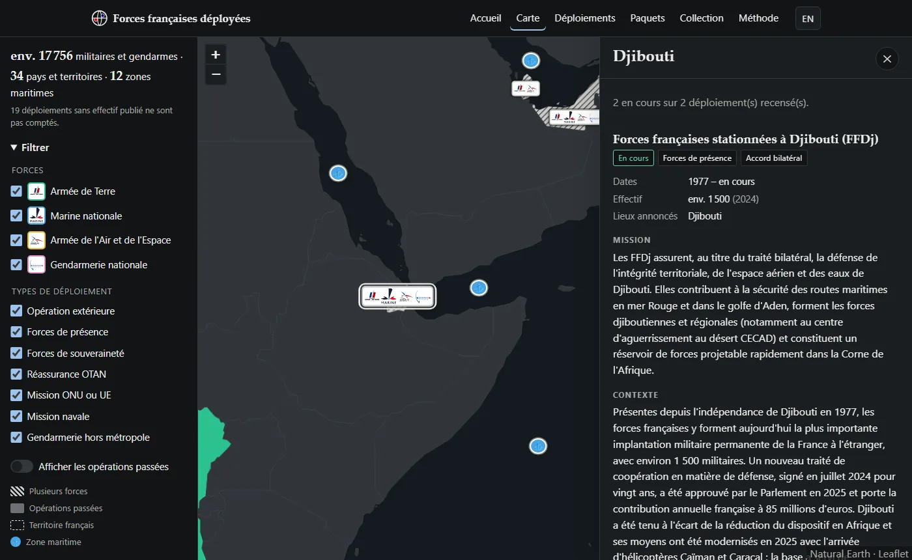

# Forces françaises déployées

*[English version below](#english)*

Carte interactive des déploiements des forces armées françaises (Armée de Terre, Marine nationale, Armée de l'Air et de l'Espace) et de la Gendarmerie nationale hors de métropole : opérations extérieures, forces de présence, forces de souveraineté outre-mer, missions de l'OTAN, de l'ONU et de l'Union européenne, missions navales. Chaque fiche donne la mission, le contexte, les effectifs, les unités, le matériel, le cadre, les dates et les sources. Le site propose aussi des cartes à collectionner tirées des mêmes données.

**Site : https://maximator13.github.io/forces-francaises/**



Site non officiel, sans lien avec le ministère des Armées ni la Gendarmerie nationale. Données issues de sources publiques, possiblement incomplètes.

## Méthode et sources

- Sources officielles en priorité : ministère des Armées et État-major des armées, Gendarmerie nationale, rapports de l'Assemblée nationale et du Sénat, Légifrance, ONU, OTAN, Union européenne. La presse ne sert qu'à confirmer une date ou un retrait sans page officielle.
- Aucun chiffre, aucune unité ni aucun matériel n'est estimé : une information non publiée vaut `null` et s'affiche « Non communiqué ».
- Localisation au niveau du pays, du territoire ou de la ville et de la base officiellement annoncés.
- Chaque entrée cite au moins une source avec sa date de consultation, et porte la date de sa dernière vérification.

Le détail est sur la page [Méthode](https://maximator13.github.io/forces-francaises/methode.html).

## Organisation

```
index.html, carte.html, deploiements.html, paquets.html, collection.html, methode.html …
css/        styles (communs, carte, cartes à collectionner, accueil)
js/         modules ES : données, carte, fiche, filtres, liste, cartes, traductions
js/pages/   un point d'entrée par page
i18n/       chaînes d'interface fr.json et en.json
data/       deployments.json, catalogue.json, places.json, schema.json, world.geojson
scripts/    validate_data.py, check_sources.py, build_basemap.py
tests/      test du tirage des paquets (node --test)
```

Le site est en HTML, CSS et JavaScript natifs, sans framework ni étape de compilation. La carte utilise [Leaflet](https://leafletjs.com/) 1.9.4 et un fond [Natural Earth](https://www.naturalearthdata.com/) stocké dans le dépôt, sans tuiles ni clé d'API.

## Lancer le site en local

```bash
python -m http.server 8000
```

Puis ouvrir http://localhost:8000. Un serveur est nécessaire car les données sont chargées avec `fetch`.

## Ajouter ou corriger un déploiement

1. Modifier `data/deployments.json`. Un déploiement ressemble à ceci (champs complets dans `data/schema.json`) :

   ```json
   {
     "id": "ffdj",
     "nom": { "fr": "Forces françaises stationnées à Djibouti", "en": "French Forces stationed in Djibouti" },
     "statut": "actif",
     "type": "presence",
     "cadre": "bilateral",
     "date_debut": "1977",
     "date_fin": null,
     "zones": ["DJI"],
     "lieux": [{ "nom": { "fr": "Djibouti", "en": "Djibouti" }, "lat": 11.59, "lon": 43.15 }],
     "composantes": [
       { "force": "terre", "specialite": null, "unites": ["5e-riaom"], "materiel": ["caesar"],
         "effectif": { "valeur": null, "approximatif": false } }
     ],
     "effectif_total": { "valeur": 1500, "approximatif": true, "date_reference": "2024" },
     "mission": { "fr": "…", "en": "…" },
     "contexte": { "fr": "…", "en": "…" },
     "rarete": "rare",
     "sources": [{ "titre": "…", "url": "https://www.defense.gouv.fr/…", "date_consultation": "2026-11-02" }],
     "derniere_verification": "2026-11-02"
   }
   ```

   - `statut` : `actif` ou `termine` (une opération terminée a une `date_fin`).
   - `type` : `opex`, `presence`, `souverainete`, `otan`, `onu_ue`, `naval`, `gendarmerie`.
   - `cadre` : `national`, `onu`, `otan`, `ue`, `bilateral`, `coalition`.
   - `zones` : code ISO 3166-1 alpha-3 du pays ou du territoire (`GUF`, `NCL`, `PYF`…), ou zone maritime `MER-…` définie dans `data/places.json`.
   - `composantes[].force` : `terre`, `marine`, `air`, `gendarmerie` ; `specialite` (gendarmerie seulement) : `mobile`, `prevotale`, `outre_mer`, `international`.
   - `unites` et `materiel` renvoient aux identifiants de `data/catalogue.json`, où chaque unité ou matériel a son nom en deux langues, sa force, sa rareté et, s'il a une description, ses sources.
   - `rarete` (cartes à collectionner) : `commune`, `peu_commune`, `rare`, `legendaire`.
2. Vérifier les données :

   ```bash
   pip install -r scripts/requirements.txt
   python scripts/validate_data.py
   ```

   Le script contrôle le schéma, les identifiants, les références au catalogue, la cohérence statut et dates, les zones connues et les traductions.
3. Vérifier les liens des sources (facultatif, une minute environ) :

   ```bash
   python scripts/check_sources.py
   ```

4. Ouvrir une demande de modification. La validation tourne automatiquement sur chaque push et chaque demande.

Le fond de carte se régénère avec `python scripts/build_basemap.py` (nécessite `shapely`).

## Automatisation

- `validate.yml` : validation des données et test du tirage à chaque push et demande de modification.
- `pages.yml` : déploiement sur GitHub Pages à chaque push sur `main`.
- `check-sources.yml` : le 1er de chaque mois, test des liens et des dates de vérification ; une issue étiquetée `verification-sources` liste les liens morts et les entrées de plus de 6 mois, puis se ferme quand tout est réglé.

## Mise en ligne

Dans les réglages du dépôt : *Pages* → *Source* : *GitHub Actions*, et cocher *Enforce HTTPS*. La mesure d'audience utilise [GoatCounter](https://www.goatcounter.com/) (sans cookie, chargé seulement après consentement) : créer le site `maximator13` sur goatcounter.com, ou changer l'adresse dans `js/consent.js`. Pour la Google Search Console, ajouter la propriété `https://maximator13.github.io/forces-francaises/` et soumettre `sitemap.xml`.

## Licences

- Code : [MIT](LICENSE).
- Données (`data/`) : [CC BY 4.0](LICENSE-DATA).
- Fond de carte : Natural Earth, domaine public.
- Logos des armées (`img/forces/`) : marques de leurs titulaires, utilisées pour identifier chaque force. Vectorisations issues de Wikimedia Commons : Armée de Terre (Cheposo, CC BY-SA 3.0), Marine nationale (SIRPA Marine, CC BY-SA 4.0), Armée de l'Air et de l'Espace et Gendarmerie nationale (domaine public).

---

<a id="english"></a>

# French forces deployed

Interactive map of French armed forces (Army, Navy, Air and Space Force) and Gendarmerie deployments outside mainland France: overseas operations, prepositioned forces, overseas sovereignty forces, NATO, UN and EU missions, naval missions. Each entry gives the mission, context, strength, units, equipment, framework, dates and sources. The site also offers collectible cards built from the same data.

**Website: https://maximator13.github.io/forces-francaises/**

Unofficial website, not affiliated with the French Ministry of the Armed Forces or the Gendarmerie nationale. Data from public sources, possibly incomplete.

## Method and sources

- Official sources first: Ministry of the Armed Forces and Defence Staff, Gendarmerie nationale, National Assembly and Senate reports, Légifrance, UN, NATO, European Union. Press articles only confirm a date or a withdrawal with no official page.
- No figure, unit or equipment is estimated: unpublished information is `null` and shown as "Not disclosed".
- Locations stop at the country, territory, or officially announced city and base.
- Every entry cites at least one source with its access date and shows when it was last checked.

## Running locally

```bash
python -m http.server 8000
```

Then open http://localhost:8000.

## Adding or fixing a deployment

1. Edit `data/deployments.json` (see the example and field list above, and `data/schema.json`). Units and equipment refer to ids in `data/catalogue.json`; sea zones are defined in `data/places.json`.
2. Run `pip install -r scripts/requirements.txt` then `python scripts/validate_data.py`.
3. Optionally run `python scripts/check_sources.py` to test source links.
4. Open a pull request; validation runs automatically.

## Licences

- Code: [MIT](LICENSE).
- Data (`data/`): [CC BY 4.0](LICENSE-DATA).
- Base map: Natural Earth, public domain.
- Service logos (`img/forces/`): trademarks of their owners, used to identify each service. Vector files from Wikimedia Commons: French Army (Cheposo, CC BY-SA 3.0), French Navy (SIRPA Marine, CC BY-SA 4.0), Air and Space Force and Gendarmerie (public domain).
