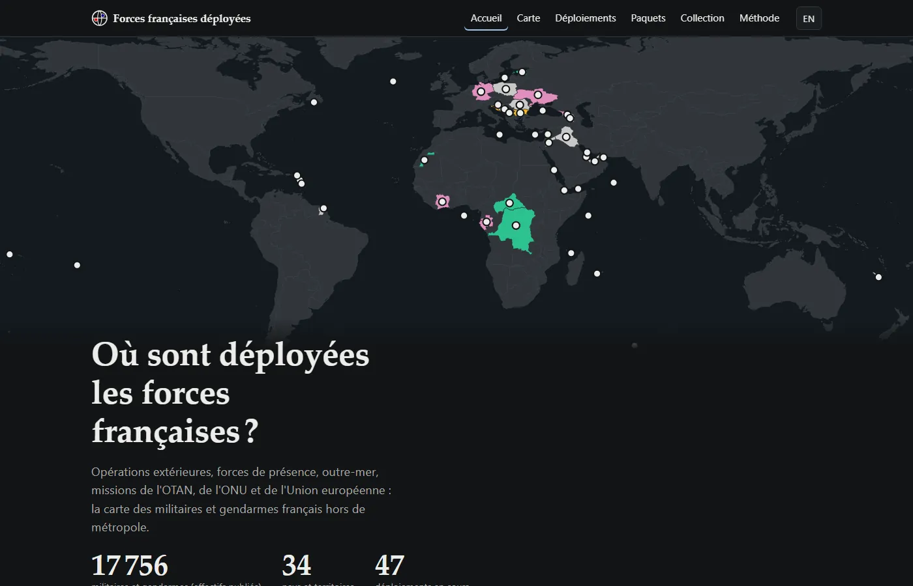
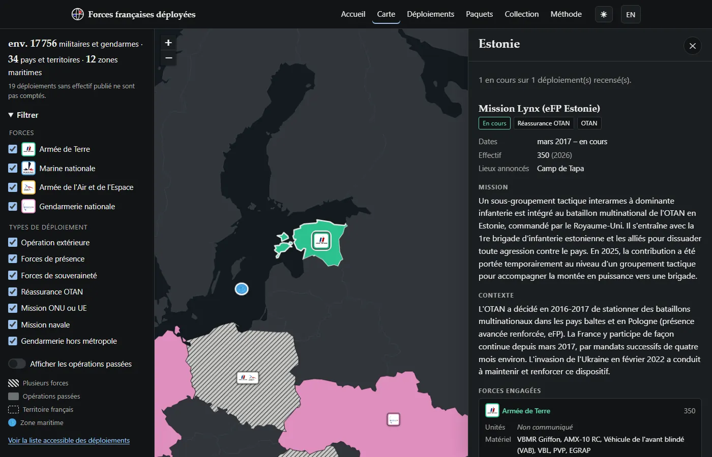
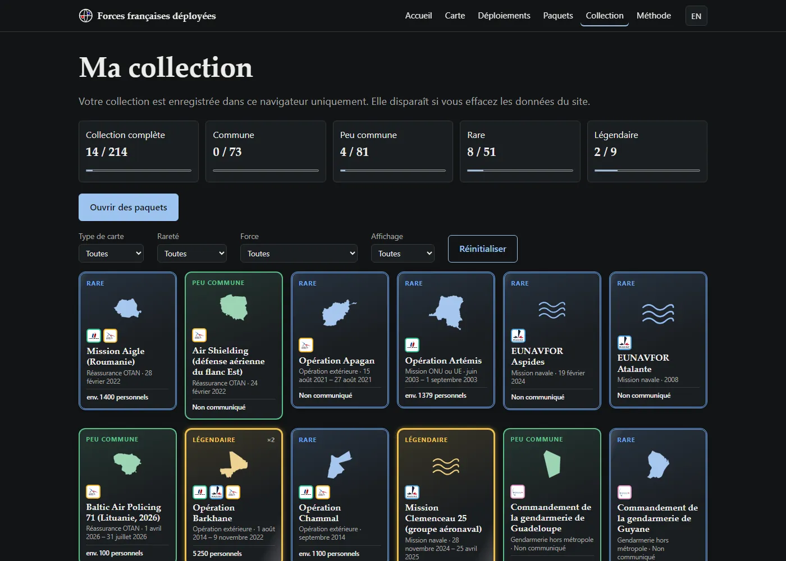

<div align="center">


# Forces françaises déployées

**Où sont les militaires et les gendarmes français, et pour quoi faire ?**<br>
Une carte du monde, des fiches sourcées, et des cartes à collectionner.

[**🌍 Voir le site**](https://maximator13.github.io/forces-francaises/) · [Méthode](https://maximator13.github.io/forces-francaises/methode.html) · [Signaler une erreur](https://github.com/Maximator13/forces-francaises/issues) · [English](#english)

[](https://github.com/Maximator13/forces-francaises/actions/workflows/validate.yml)
[](https://github.com/Maximator13/forces-francaises/actions/workflows/pages.yml)
[](LICENSE)
[](LICENSE-DATA)




</div>

## En quelques chiffres

| 🎖️ | |
|---|---|
| **47** | déploiements en cours |
| **34** | pays et territoires, plus **12** zones maritimes |
| **≈ 17 800** | militaires et gendarmes, d'après les effectifs publiés |
| **27** | opérations terminées, de Daguet (1990) aux missions de 2026 |
| **136** | sources publiques citées |
| **227** | cartes à collectionner |

*Chiffres au 2 novembre 2026. Les déploiements sans effectif publié ne sont pas comptés.*

## Ce que vous y trouverez

### 🗺️ La carte

Armée de Terre, Marine nationale, Armée de l'Air et de l'Espace, Gendarmerie : chaque pays, territoire d'outre-mer ou zone maritime où elles sont présentes s'allume. Un clic ouvre la fiche : mission, contexte, effectifs, unités, matériel, cadre (national, OTAN, ONU, UE…), dates et sources.

- Filtres par force et par type (OPEX, forces de présence, souveraineté, OTAN, ONU/UE, missions navales, gendarmerie), combinables.
- Un compteur qui suit les filtres.
- Les opérations terminées (Serval, Barkhane, Licorne…) sont là, grisées, derrière un interrupteur discret.
- Un lien partageable : `…/carte.html#fr/DJI` ouvre directement Djibouti.

<div align="center"></div>

### 📋 La liste

La même chose sous forme de tableau triable : pratique au clavier, avec un lecteur d'écran ou sur un petit écran.

### 🃏 Les cartes à collectionner

Chaque déploiement, régiment, navire ou avion des données devient une carte, illustrée par une vraie photo ou par l'insigne de l'unité. Ouvrez des paquets de 5 (autant que vous voulez, sans attente), retournez les cartes et complétez votre collection, de *commune* à *légendaire*.

| Rareté | Chance par carte | Exemples |
|---|---|---|
| Commune | 65 % | régiments, matériels courants |
| Peu commune | 25 % | missions OTAN, présences navales |
| Rare | 8 % | FFDj, Chammal, Atalante, Licorne |
| **Légendaire** | 2 % | Serval, Barkhane, Daguet, le porte-avions Charles de Gaulle |

Au moins une peu commune par paquet. Aucune statistique inventée : les cartes ne montrent que des informations publiées. La collection reste dans votre navigateur.

<div align="center"></div>

### Et aussi

- 🇫🇷 / 🇬🇧 Français et anglais, avec un sélecteur de langue.
- 🌙 Mode sombre automatique ou au choix (bouton ☾/☀), animations désactivées si vous les réduisez dans votre système.
- ♿ Navigation complète au clavier, contrastes AA, la couleur n'est jamais le seul repère : logos des armées, hachures, pointillés.
- 🔒 Aucun cookie. Mesure d'audience sans cookie, chargée seulement si vous l'acceptez.

## Comment c'est construit

- **Sources officielles d'abord** : ministère des Armées, État-major des armées, Gendarmerie nationale, Assemblée nationale, Sénat, ONU, OTAN, Union européenne.
- **Rien n'est estimé** : un chiffre non publié s'affiche « Non communiqué ».
- **Localisation prudente** : pays, territoire, ou ville et base officiellement annoncées, jamais plus précis.
- **Traçable** : chaque entrée cite ses sources avec leur date de consultation.

Côté technique, c'est volontairement simple : HTML, CSS et JavaScript en modules natifs, sans framework ni compilation. La carte utilise [Leaflet](https://leafletjs.com/) sur un fond [Natural Earth](https://www.naturalearthdata.com/) stocké dans le dépôt, sans tuiles ni clé d'API. L'outillage des données est en Python.

```
├── index.html, carte.html, deploiements.html, paquets.html, collection.html, methode.html…
├── css/          styles : communs, carte, cartes à collectionner, accueil
├── js/           modules : données, carte, fiche, filtres, liste, cartes, traductions
│   └── pages/    un point d'entrée par page
├── i18n/         textes de l'interface (fr.json, en.json)
├── data/         deployments.json, catalogue.json, places.json, schema.json, world.geojson
├── scripts/      validate_data.py, check_sources.py, build_basemap.py
└── tests/        test du tirage des paquets
```

## Lancer en local

```bash
python -m http.server 8000
```

Puis ouvrir http://localhost:8000. Un petit serveur est nécessaire, car les données sont chargées avec `fetch`.

## Contribuer

Une erreur, un déploiement oublié, une source morte ? [Ouvrez une issue](https://github.com/Maximator13/forces-francaises/issues) ou proposez une modification.

1. **Modifiez `data/deployments.json`.** Exemple d'entrée (le format complet est dans `data/schema.json`) :

   ```json
   {
     "id": "ffdj",
     "nom": { "fr": "Forces françaises stationnées à Djibouti", "en": "French Forces stationed in Djibouti" },
     "statut": "actif",
     "type": "presence",
     "cadre": "bilateral",
     "date_debut": "1977",
     "date_fin": null,
     "zones": ["DJI"],
     "lieux": [{ "nom": { "fr": "Djibouti", "en": "Djibouti" }, "lat": 11.59, "lon": 43.15 }],
     "composantes": [
       { "force": "terre", "specialite": null, "unites": ["5e-riaom"], "materiel": ["caesar"],
         "effectif": { "valeur": null, "approximatif": false } }
     ],
     "effectif_total": { "valeur": 1500, "approximatif": true, "date_reference": "2024" },
     "mission": { "fr": "…", "en": "…" },
     "contexte": { "fr": "…", "en": "…" },
     "rarete": "rare",
     "sources": [{ "titre": "…", "url": "https://www.defense.gouv.fr/…", "date_consultation": "2026-11-02" }],
     "derniere_verification": "2026-11-02"
   }
   ```

   | Champ | Valeurs |
   |---|---|
   | `statut` | `actif` ou `termine` (une opération terminée a une `date_fin`) |
   | `type` | `opex`, `presence`, `souverainete`, `otan`, `onu_ue`, `naval`, `gendarmerie` |
   | `cadre` | `national`, `onu`, `otan`, `ue`, `bilateral`, `coalition` |
   | `zones` | code ISO 3166-1 alpha-3 (`DJI`, `GUF`, `NCL`…) ou zone maritime `MER-…` de `data/places.json` |
   | `force` | `terre`, `marine`, `air`, `gendarmerie` ; pour la gendarmerie, `specialite` : `mobile`, `prevotale`, `outre_mer`, `international` |
   | `unites`, `materiel` | identifiants de `data/catalogue.json` (nom bilingue, force, rareté, sources) |
   | `rarete` | `commune`, `peu_commune`, `rare`, `legendaire` |
   | dates | `AAAA`, `AAAA-MM` ou `AAAA-MM-JJ`, à la précision publiée |

2. **Vérifiez** :

   ```bash
   pip install -r scripts/requirements.txt
   python scripts/validate_data.py
   ```

   Le script contrôle le schéma, les identifiants, les références au catalogue, la cohérence entre statut et dates, les zones et les traductions.

3. **Testez les liens** (facultatif, environ une minute) : `python scripts/check_sources.py`.

Le fond de carte se régénère avec `python scripts/build_basemap.py`.

## Automatisation

| Workflow | Quand | Quoi |
|---|---|---|
| `validate.yml` | chaque push et chaque demande de modification | validation des données, test du tirage des paquets |
| `pages.yml` | chaque push sur `main` | déploiement sur GitHub Pages |
| `check-sources.yml` | le 1er de chaque mois | test des liens et des dates de vérification ; une issue `verification-sources` liste les liens morts et les entrées de plus de 6 mois, puis se ferme quand tout est réglé |

## Questions fréquentes

**C'est un site officiel ?** Non. Il n'a aucun lien avec le ministère des Armées ni la Gendarmerie nationale. Il compile des informations publiques et peut être incomplet.

**Pourquoi certains effectifs sont « Non communiqués » ?** Parce qu'ils ne sont pas publiés. Le site préfère un blanc honnête à un chiffre inventé.

**Pourquoi le total ne correspond pas aux chiffres officiels ?** Il additionne seulement les effectifs publiés, à des dates de référence différentes. C'est un ordre de grandeur.

**Mes cartes sont sauvegardées ?** Oui, dans votre navigateur. Elles disparaissent si vous effacez les données du site.

## Licences et crédits

- Code : [MIT](LICENSE).
- Données (`data/`) : [CC BY 4.0](LICENSE-DATA). Merci de citer « Forces françaises déployées ».
- Fond de carte : [Natural Earth](https://www.naturalearthdata.com/), domaine public.
- Logos des armées (`img/forces/`) : marques de leurs titulaires, utilisées pour identifier chaque force, sans lien ni approbation. Fichiers issus de Wikimedia Commons : Armée de Terre (Cheposo, CC BY-SA 3.0), Marine nationale (SIRPA Marine, CC BY-SA 4.0), Armée de l'Air et de l'Espace et Gendarmerie nationale (domaine public).
- Photos et insignes des cartes (`img/catalogue/`) : Wikimedia Commons, licences libres ; auteur, licence et lien affichés sur chaque carte et enregistrés dans `data/catalogue.json` (champ `image`).

---

<a id="english"></a>

<div align="center">

# 🇬🇧 French forces deployed

**Where are French service members and gendarmes deployed, and why?**<br>
A world map, sourced fact sheets, and collectible cards.

[**🌍 Visit the website**](https://maximator13.github.io/forces-francaises/) · [Report an error](https://github.com/Maximator13/forces-francaises/issues)

</div>

- 🗺️ **Map**: every country, overseas territory and maritime area where the French Army, Navy, Air and Space Force or Gendarmerie are present. Click for the mission, context, strength, units, equipment, framework, dates and sources. Filter by service and deployment type, show past operations, share a link (`…/carte.html#en/DJI`).
- 📋 **List**: the same data as a sortable table, keyboard and screen reader friendly.
- 🃏 **Cards**: every deployment, regiment, ship and aircraft becomes a collectible card. Open as many 5-card packs as you like, from *common* to *legendary*.
- 🔍 **Method**: official sources first; nothing is estimated ("Not disclosed" when unpublished); locations no more precise than officially announced; every entry cites its sources.

Unofficial website, not affiliated with the French Ministry of the Armed Forces or the Gendarmerie nationale. Data from public sources, possibly incomplete.

**Run locally**: `python -m http.server 8000`, then open http://localhost:8000.

**Contribute**: edit `data/deployments.json` (see the example and field table above, and `data/schema.json`), then run `pip install -r scripts/requirements.txt` and `python scripts/validate_data.py`. Optionally check source links with `python scripts/check_sources.py`. Pull requests are validated automatically.

**Licences**: code [MIT](LICENSE), data [CC BY 4.0](LICENSE-DATA), base map Natural Earth (public domain). Service logos are trademarks of their owners, used for identification only (Wikimedia Commons: French Army by Cheposo, CC BY-SA 3.0; French Navy by SIRPA Marine, CC BY-SA 4.0; Air and Space Force and Gendarmerie, public domain). Card photos and insignia come from Wikimedia Commons under free licences; author, licence and link are shown on each card.
